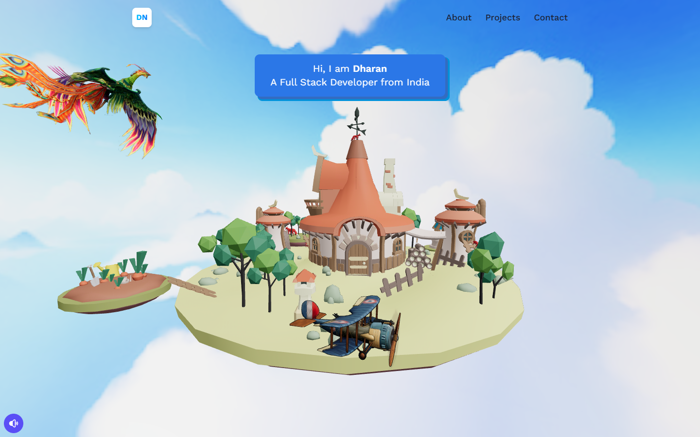
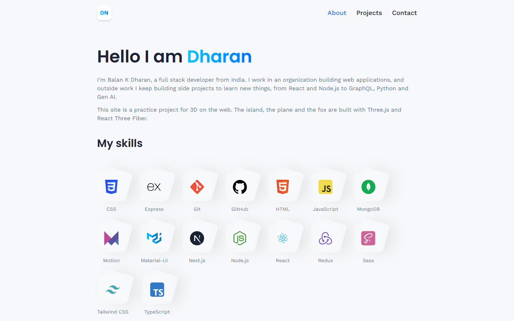
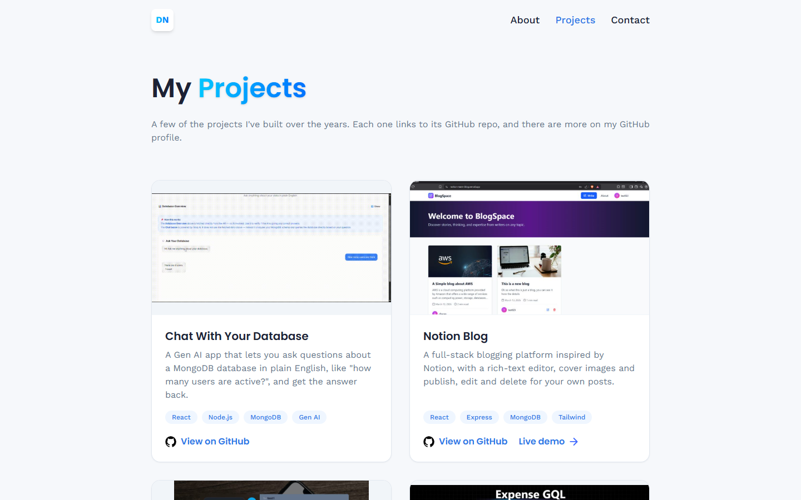
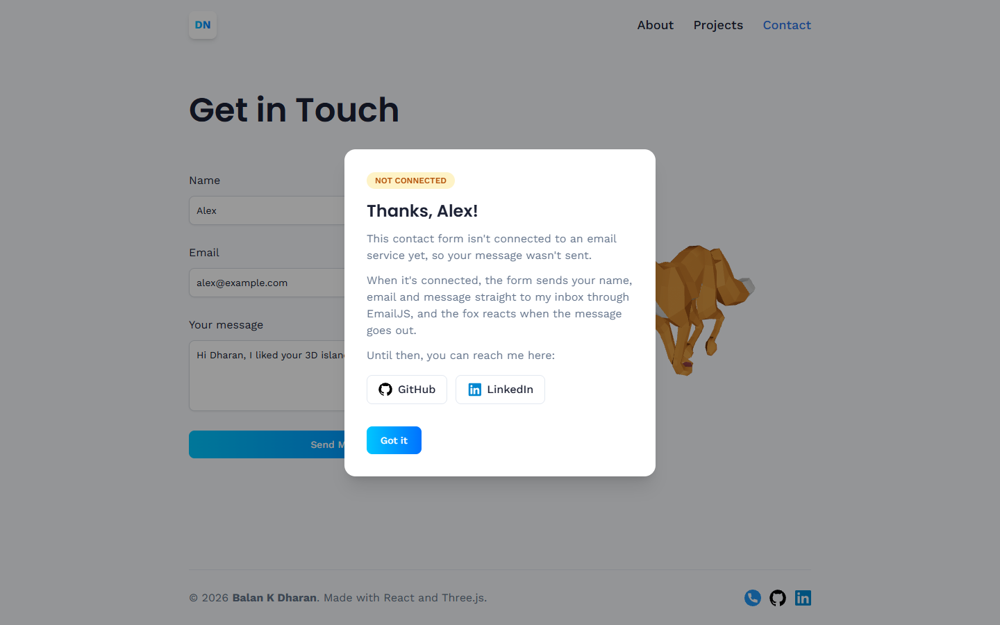

# 3D Portfolio (Three.js practice)

A portfolio site with an interactive 3D island, built to practise 3D on the web with Three.js and React Three Fiber. Drag or use the arrow keys to spin the island, and info boxes about me pop up as you go. There are also About, Projects (with screenshots of my work) and Contact pages.

This project was for practising 3D only. It has no backend or database: all the content lives in `src/constants/index.js`.

## Screenshots

| Home (3D island) | About |
|:---:|:---:|
|  |  |

| Projects | Contact |
|:---:|:---:|
|  |  |

## What I practised

- Loading and animating GLTF models (island, sky, plane, bird, fox) with React Three Fiber and Drei
- Rotating the island with drag and the keyboard, and showing a different info box for each side
- Scaling the scene to the screen size
- Playing a different fox animation when you type in the contact form or send it
- Background music with a mute button
- A loading screen that stays up until the 3D scene has actually drawn, with a message for browsers that can't run WebGL

## Contact form

The contact form is built for EmailJS but isn't connected yet. When you send a message, a dialog explains that and links to my GitHub and LinkedIn instead.

To connect it, create a free account at [EmailJS](https://www.emailjs.com), copy `.env.example` to `.env` and fill in the three keys. The form then sends messages for real.

## Getting started

You need Node.js 18 or newer.

```bash
git clone https://github.com/balankdharan/threejs-portfolio.git
cd threejs-portfolio
npm install
npm run dev
```

Then open the address Vite prints (usually http://localhost:5173).

To build for production:

```bash
npm run build
npm run preview
```

## Notes

- The 3D scenes need WebGL. They run best with hardware acceleration on; on software rendering they can take several seconds to appear, and the loading screen shows while that happens.
- The site has one light theme and doesn't follow the system's dark mode.

## Built with

- React 18 and Vite
- Three.js with React Three Fiber and Drei
- Tailwind CSS
- React Router
- EmailJS (contact form, optional)

## Credits

The fox's island model is by [nimzu](https://sketchfab.com/nimzuk) on Sketchfab, licensed under [CC BY 4.0](http://creativecommons.org/licenses/by/4.0/).
